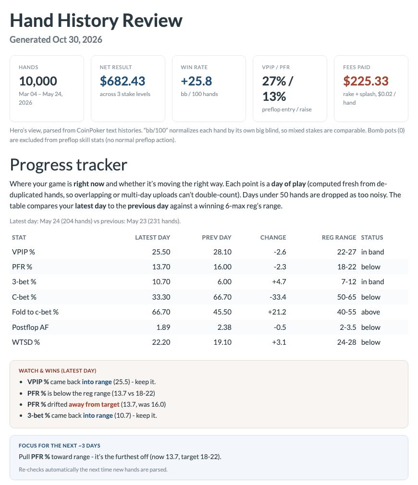
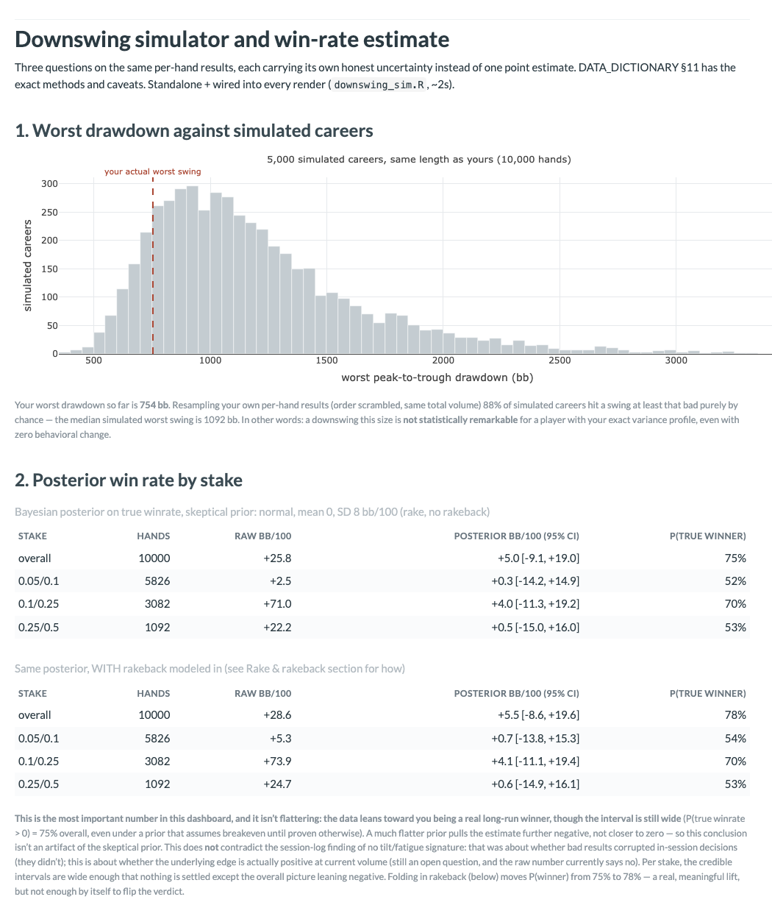
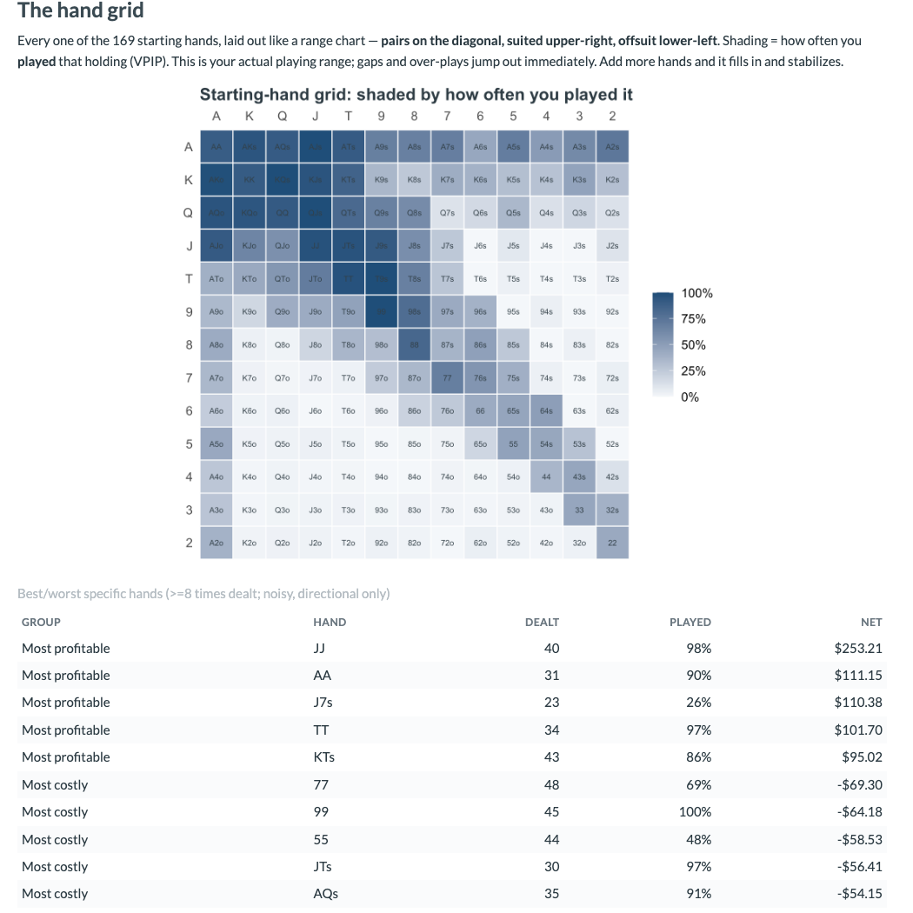
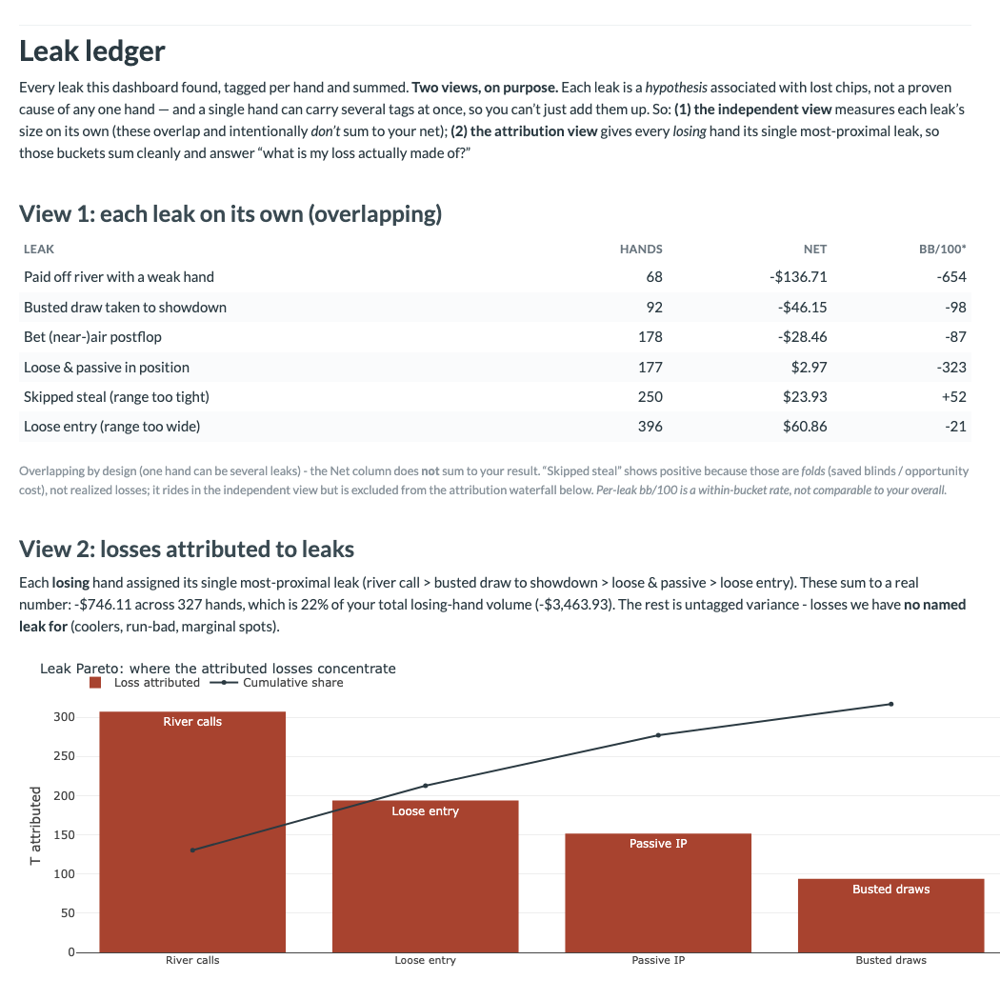

# poker-hand-review

Turns online poker hand histories into a one-page review of how you actually play.



I wanted an honest answer to "am I winning, and why?" that a tracker's headline win rate doesn't give. The review shows results by stake and table, positional and postflop tendencies, how much of a downswing was cards versus decisions, and an estimate of the true win rate with its uncertainty. Everything above is built from simulated hands, so it runs without anyone's real history.

| | |
|---|---|
|  |  |
|  | |

## Run it

Needs R (dplyr, ggplot2, plotly, scales, stringr, tidyr, rmarkdown) and Python 3.10+.

```
python -m venv .venv && .venv/bin/pip install -r requirements.txt
.venv/bin/python simulate_hands.py --hands 10000 --out hands
Rscript render_coinpoker.R            # about 2.5 minutes; --quick skips the luck ledger
```

```
Read 50 files, 10000 hand blocks; removed 0 duplicate id(s) -> 10000 unique hands.
Stack-delta validation on 9898 pairs: 99.1% exact, 100.0% explained by net + top-up.
Done -> coinpoker_dashboard.html
```

Out come `coinpoker_dashboard.html` (about 20 sections), one CSV per hand and per analysis (`DATA_DICTIONARY.md` defines every column), and two side tools: a flashcard trainer built from missed spots and a year-in-review page.

## What it answers

| Question | How |
|---|---|
| Is this drawdown unusual? | Bootstrap of 5,000 simulated careers, plus risk of ruin |
| What's my real win rate? | A posterior interval and the chance I'm a long-run winner |
| Cards or decisions? | Splits the deepest drawdown into cards dealt, all-in luck, river cards and what's left |
| What would simple rules have done? | Replays the same hands with rules like "fold loose hands" or a stop-loss |
| Is the deck fair? | Chi-square tests on ranks, suits and cards |
| Do I tilt? | Compares play in the hands after a big loss |

## Why it's built this way

- **The parser is checked against the stack.** A hand's net plus any top-up should equal the stack at the next hand at that table. That check runs on every parse.
- **Simulated hands with known answers.** `simulate_hands.py` plays each hand through PokerKit's engine, so pots and side pots are exact, and records the true result. The tests check the parser recovers it on every hand, to the cent.
- **Planted leaks.** The simulated player calls too wide in position and folds too often to continuation bets. The dashboard should flag both, and it does.
- **Uncertainty on every headline number.** 10,000 hands can't separate a small edge from noise, so win rates come with an interval.
- **Sentences are computed, not typed.** Every stated result is generated from the data on the page.

## Limits

- Opponents are only seen at showdown, which skews toward their strong hands.
- Leak tags are heuristics on one player's hands, not a solver comparison.
- The simulated players exercise the pipeline; they don't play like people.
- Only CoinPoker's cash-game export is parsed. The parser is also available in Python (`parse_coinpoker.py`), tested against the R version.

MIT license. Not affiliated with CoinPoker. No real hand histories are included.
